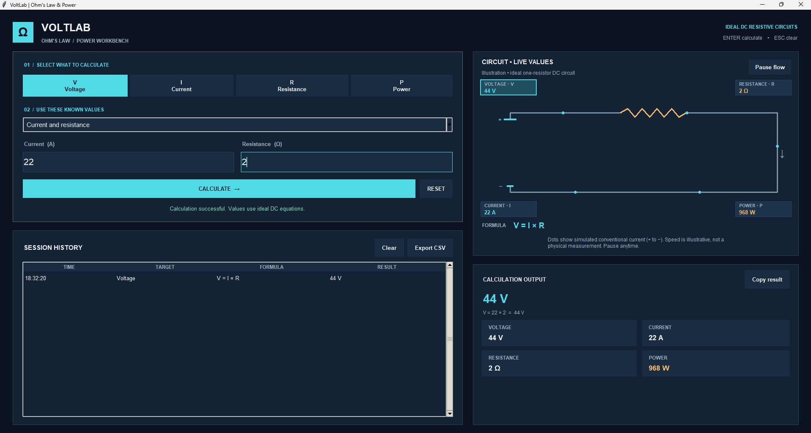

# VoltLab — Ohm's Law & Power Calculator

**Python mini project | ND1 Mechatronics Engineering | Yaba College of Technology (YABATECH)**

**Student:** Adisa Abdulrahmon Olamilekan  
**GitHub:** [RaynerdTech](https://github.com/RaynerdTech)  
**Intended repository:** [adisa-ohms-law-calculator](https://github.com/RaynerdTech/adisa-ohms-law-calculator) (the link becomes available after this repository is published)

VoltLab is a self-contained Python desktop calculator for an **ideal single-resistor DC circuit**. It finds voltage, current, resistance, or power from two known values, shows the actual equation and substitution, displays related quantities, and illustrates the circuit with a readable animated schematic.



## What it does

1. Choose the unknown quantity: **Voltage (V)**, **Current (I)**, **Resistance (R)**, or **Power (P)**.
2. Choose the pair of **known values**. For clarity, labels use “and,” not “+”; this is a choice of inputs, **not** a mathematical operation.
3. Enter the two numbers using their stated units (**V, A, Ω, or W**), and press **Calculate** (or **Enter**).
4. Read the result and substituted equation; inspect the four circuit values on the diagram and in the output cards.
5. Repeat as needed, copy a result, review session history, or export calculations to CSV.

### All 12 calculation methods

| Unknown | Known inputs | Equation |
|---|---|---|
| Voltage | Current and resistance | `V = I × R` |
| Voltage | Power and current | `V = P / I` |
| Voltage | Power and resistance | `V = √(P × R)` |
| Current | Voltage and resistance | `I = V / R` |
| Current | Power and voltage | `I = P / V` |
| Current | Power and resistance | `I = √(P / R)` |
| Resistance | Voltage and current | `R = V / I` |
| Resistance | Voltage and power | `R = V² / P` |
| Resistance | Power and current | `R = P / I²` |
| Power | Voltage and current | `P = V × I` |
| Power | Current and resistance | `P = I² × R` |
| Power | Voltage and resistance | `P = V² / R` |

**Scope:** The calculator uses the ideal resistive DC model with non-negative inputs. It is not an AC simulator, a multi-component circuit solver, or a substitute for laboratory measurement. Invalid entries, unbounded values, and division by zero are handled with error messages. When an additional quantity cannot be determined uniquely, it is displayed as `—`.

## How to run it

**Requirements:** Python 3 and Tkinter (included with many desktop Python installations). No pip packages, internet connection, accounts, API keys, or 3D tools are necessary.

1. Download or clone the repository.
2. Open the project folder in **VS Code** or a terminal.
3. Run:

```powershell
python ohms_law.py
```

On Windows, `py ohms_law.py` also works if Python is installed using the Windows launcher. On Linux, Tkinter may require the separately installed `python3-tk` package.

**Shortcuts:** Enter = calculate; Esc = clear inputs/results; Ctrl+Shift+C = copy the selected result.

## Sample calculation

```text
Selected quantity:  Power
Known values:       Voltage = 12 V; Current = 2 A
Equation:           P = V × I
Substituted values: P = 12 × 2
Answer:             24 W
Other circuit data: Voltage = 12 V; Current = 2 A; Resistance = 6 Ω
```

## My own twist and its purpose

The compulsory extra features are more than a new calculation option:

- **12 formula paths** allow the user to choose whichever two measurements are available.
- **Live annotated schematic:** Voltage, current, resistance, and power appear as values directly on the circuit. The selected target has a highlighted outline.
- **Animated conventional current:** Dots move from the battery's **positive (+)** side through the resistor toward its **negative (−)** side. The **Pause flow / Resume flow** button controls the animation independently of the calculation. Dots appear only when a calculated current is positive.
- **Honest animation labeling:** Dot speed changes with current using an illustrative logarithmic scale; it is **not an actual measurement or physical drift-speed simulation**.
- **Worked equation and related metrics:** Instead of only a final answer, the screen shows the substituted formula and all uniquely determinable quantities.
- **Session history and CSV export:** Calculations can be reviewed or saved as a record; they are not automatically retained across restarts.
- **Engineering-prefix formatting:** Results can display milli (`m`), micro (`µ`), kilo (`k`), mega (`M`), and other appropriate prefixes for readability.

## Intentional UI/UX — layout and colors

- **Left-to-right engineering workflow:** **Select target → choose known inputs → enter values → calculate** sits on the left, while the circuit and answers appear on the right. This gives a predictable path from task to outcome without requiring a user manual.
- **Circuit at upper right:** The schematic displays the meaning and location of each computed quantity. Values update after a successful calculation, the selected target is highlighted, and the simulation has an explicit Pause/Resume control.
- **Result cards below the circuit:** The primary answer is prominent; supporting quantities are grouped directly beneath it for comparison. History is under the calculator because it records previous user actions.
- **Deep navy (`#0B1320`)** provides a consistent high-contrast engineering workbench background. **Cyan (`#50DBE7`)** identifies selected controls, active input, and current/voltage information. **Amber (`#F3B868`)** identifies the resistor and power. **Green (`#79DAB4`)** means a successful calculation; **red (`#FF9696`)** means input error; muted grey-blue is reserved for supporting instructions.
- **2D instead of decorative 3D:** A conventional schematic communicates DC resistor behavior more accurately than a purely visual 3D render, and works without a graphics engine.
- **Deliberate wording:** The original known-input descriptions used a plus sign, which could be mistaken for arithmetic. They now use **“and”** because the operation is determined by the displayed equation.

## Testing and development notes

For the final review, I ran VoltLab in VS Code and manually checked **all 12 calculation combinations** using a consistent example: **12 V, 2 A, 6 Ω, and 24 W**. I also reviewed the interface and raised usability issues about ambiguous “+” labels and the moving dots. Those observations informed the final labels, explanatory animation text, positive-to-negative flow direction, and Pause/Resume control.

The implementation was produced **with AI coding assistance**, with student-directed feature requirements, interface feedback, and manual testing. The included Python tests can be rerun independently:

```powershell
python -m unittest discover -s tests -v
```

The tests cover the 12 equations, invalid entries, division by zero, zero-valued valid cases, derived values, and engineering-unit formatting. The GUI has also been launched and checked for correct values and Pause/Resume behavior.

## How the required Python methods are used

| Assignment requirement | In the project |
|---|---|
| Python solution for an approved project | `ohms_law.py` |
| All four targets and units | `METHODS`, `UNITS`, `calculate_electrical()` |
| Repeats until quit | Reusable Calculate button plus `mainloop()` |
| At least one function | `parse_number()`, `calculate_electrical()`, and others |
| At least one loop | `for` loops for target buttons, metrics, and history |
| `if` / `elif` / `else` | Formula selection in `calculate_electrical()` |
| `int()` or `float()` input | `float()` in `parse_number()` |
| Handle invalid input | `try` / `except`, `safe_divide()`, finite-number checks |
| Helpful code comments | File header, docstrings, and comments explaining non-obvious logic |
| Original twist | Annotated circuit, animation control, 12 paths, history, CSV |
| GitHub and LinkedIn | Public repository and individual public post required separately |

## Project structure

```text
ohms-law-calculator/
├── ohms_law.py
├── README.md
├── .gitignore
├── assets/
│   └── project-Screenshot.png
└── tests/
    └── test_calculations.py
```

## Submission information

**Lecturer:** Sumayyah Taiwo  
**Deadline:** Wednesday, **11 November 2026, 11:59 p.m.**

Submission requires (1) the public GitHub repository with the Python file and README, (2) a personal **100–200-word** LinkedIn post containing its public URL and a proper LinkedIn tag of **Sumayyah Taiwo**, and (3) the lecturer's submission form with the student's registered name, matric number, and LinkedIn post URL. The brief contains a placeholder for the form link; the actual link must come from the lecturer. **Do not publish a matric number, password, or other private details in this repository or on LinkedIn.**

**Academic integrity:** The assignment specifies that the code must be the student's own work and that the student may be asked to explain any line. AI assistance is disclosed above; review the code and comply with your lecturer's authorship requirements before presenting it as independent work.

## Author

**Adisa Abdulrahmon Olamilekan**  
ND1 Mechatronics Engineering, Yaba College of Technology (YABATECH)  
GitHub: https://github.com/RaynerdTech
